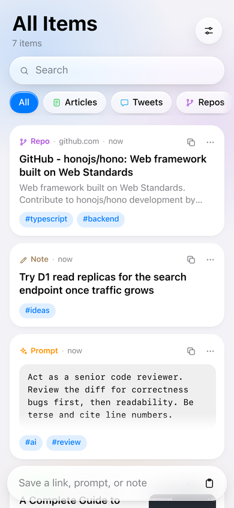
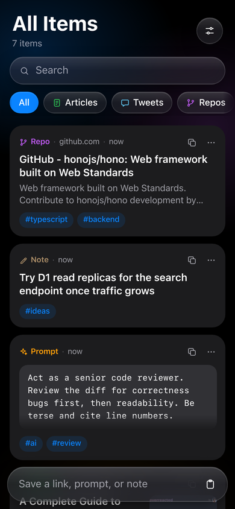
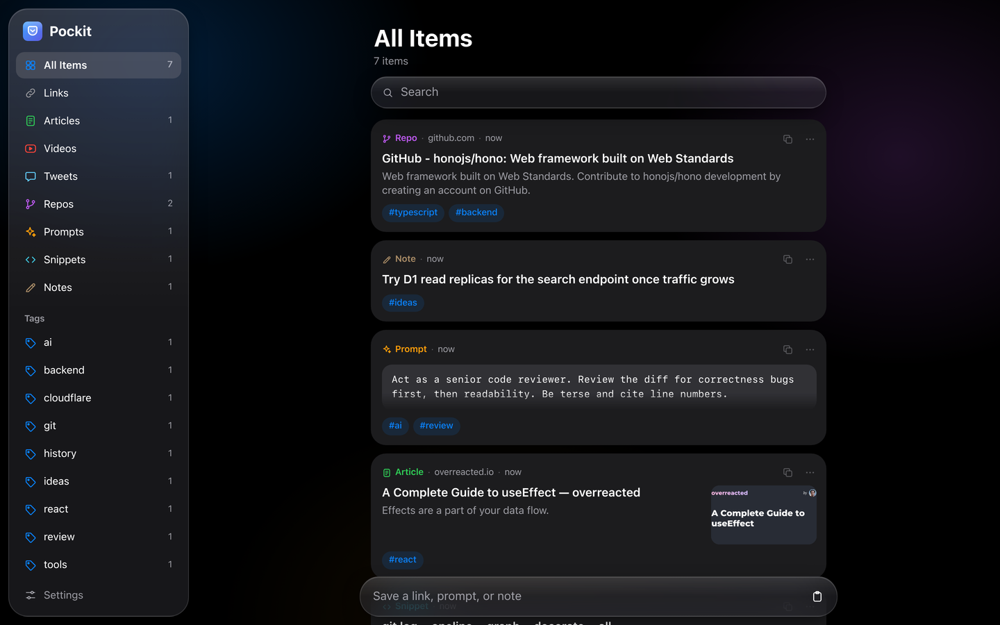

# Pockit

Save every good link, article, YouTube video, tweet, GitHub repo, AI prompt, snippet, and note in one place, and find it again with full-text search. Pockit is a personal app you host yourself on Cloudflare's free tier. It installs on your phone like an app and saves straight from the iOS and Android share sheets.

<p align="center">
  
  
</p>



## What it does

- **Paste anything.** A URL gets its title, description, and preview image filled in automatically. Plain text becomes a note, prompt, or snippet.
- **Knows what you saved.** YouTube and Vimeo become videos, X posts become tweets, GitHub and GitLab become repos, and Medium, Substack, and dev.to become articles.
- **No duplicates.** Tracking parameters such as `utm_*` and `si=` are removed, and `youtu.be`, `m.youtube.com`, and `youtube.com` links count as the same video.
- **Finds it again.** Search covers titles, content, notes, tags, and URLs, and matches word prefixes. Filter by kind or tag.
- **Saves from anywhere.** Use the iOS share sheet through a Shortcut, the Android share sheet, a desktop bookmarklet, or paste into the app.
- **Feels native.** The interface follows Apple's design language, with a Liquid Glass control layer, light and dark mode, and layouts for phone, tablet, and desktop.

## Self-host it

Pockit runs as one Cloudflare Worker with a D1 (SQLite) database. Light personal use fits in the free tier, and you need no server.

You need:

- A free [Cloudflare account](https://dash.cloudflare.com/sign-up).
- Node.js 22 or later and npm.

### Deploy

1. Clone the repo and install dependencies.

   ```sh
   git clone https://github.com/<you>/pockit.git
   cd pockit
   npm install
   ```

2. Log in to Cloudflare. A browser window opens, and you click **Allow**.

   ```sh
   npx wrangler login
   ```

3. Create the database.

   ```sh
   npx wrangler d1 create pockit
   ```

4. Open `wrangler.jsonc` and replace the `database_id` value with the id that the previous command printed.

5. Create the tables.

   ```sh
   npm run db:migrate:remote
   ```

6. Deploy.

   ```sh
   npm run deploy
   ```

   The output ends with your URL, for example `https://pockit.<your-subdomain>.workers.dev`.

7. Set the password that unlocks your Pockit. Use a long passphrase, because the URL is public and anyone can try it.

   ```sh
   npx wrangler secret put POCKIT_PASSWORD
   ```

Open your URL and log in.

### Update to a new version

```sh
git pull
npm install
npm run db:migrate:remote
npm run deploy
```

Migrations that already ran are skipped, so `db:migrate:remote` is safe to run every time.

## Save from your devices

- **iPhone and iPad.** Open your URL in Safari, tap **Share**, then **Add to Home Screen**. iOS doesn't let web apps appear in the share sheet, so build the **Save to Pockit** Shortcut instead. In Pockit, open **Settings**. It lists every step and has rows that copy your URL and token.
- **Android.** Open your URL in Chrome and choose **Install app**. Pockit then appears in the share sheet.
- **Laptop.** In **Settings**, drag **Save to Pockit** to your bookmarks bar. It saves the tab you are on. Press `/` to search, `N` to add an item, and `Ctrl+Enter` to save text.

The Shortcut sends `Authorization: Bearer <token>`. Pockit derives the token from `POCKIT_PASSWORD`, so if you change the password, the old token stops working. Paste the new **Header** row from **Settings** into the Shortcut.

## API

All routes are under `/api`. The web app logs in with a cookie from `POST /api/login`. Other clients send `Authorization: Bearer <token>`.

| Method | Route | Body or query | Returns |
|---|---|---|---|
| `POST` | `/api/login` | `{ "password": "…" }` | Sets the session cookie |
| `GET` | `/api/items` | `q`, `kind`, `tag` | Up to 200 items, newest first, or by relevance when `q` is set |
| `POST` | `/api/items` | `{ "input": "url or text", "kind"?, "tags"?, "note"? }` | The saved item and whether it was a duplicate |
| `PATCH` | `/api/items/:id` | Any of `title`, `kind`, `tags`, `note`, `body` | The updated item |
| `DELETE` | `/api/items/:id` | | `204` |
| `GET` | `/api/facets` | | Total count, counts per kind, and counts per tag |
| `GET` | `/api/token` | | The Bearer token |

A Bearer request without `Accept: application/json` gets plain text from `POST /api/items`, such as `Saved: <title>`. The iOS Shortcut shows that text as its notification. Send `Accept: application/json` to get JSON.

## Develop locally

```sh
npm install
echo 'POCKIT_PASSWORD=dev' > .dev.vars
npm run db:migrate:local
npm run dev
```

Open the URL that Vite prints and log in with `dev`. The local database lives in `.wrangler/` and never touches your deployed one. Run `npm run check` to type-check.

### How the code is laid out

- `worker/index.ts` holds the Hono API, with auth, items, search, and facets.
- `worker/kind.ts` maps URL hosts to kinds and cleans URLs for duplicate detection.
- `worker/meta.ts` fetches titles and preview images. It uses oEmbed for YouTube and X, and Open Graph tags for other pages.
- `migrations/` holds the D1 schema. Triggers keep an FTS5 search index in sync with the `items` table.
- `shared/item.ts` holds the types that the worker and the web app share.
- `src/` holds the React web app.

## License

[MIT](LICENSE)
